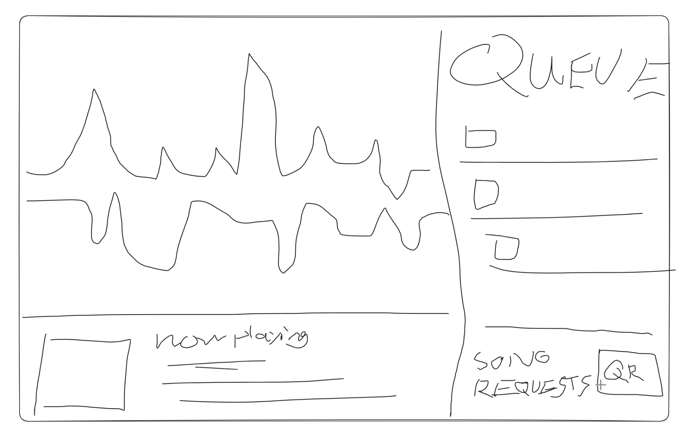

# User-provided display sketch

The user supplied this sketch during plan review. It is a composition reference,
not a finalized visual mockup or fixed pixel/resolution specification.

- Large main area on the left: an actual music-reactive visualization rendered
  with dithering in the dashboard's visual style.
- Bottom-left strip: now-playing information and artwork.
- Right sidebar: queue entries, with a song-request QR area toward the bottom.

The visualizer must listen to/analyze the real playing audio. A predetermined
shader animation alone does not satisfy that requirement. Its exact audio tap,
signal features, geometry, dithering shader, smoothing, responsiveness, and
rendering location are deliberately deferred to the display component discussion.
Do not interpret “audio listener” as requiring a room microphone; discuss the
signal path and prefer direct playing-media analysis where feasible.

The existing dashboard is a separate monitor and remains only a design reference.
Optional Lunar sharing has not been resolved by this sketch.
